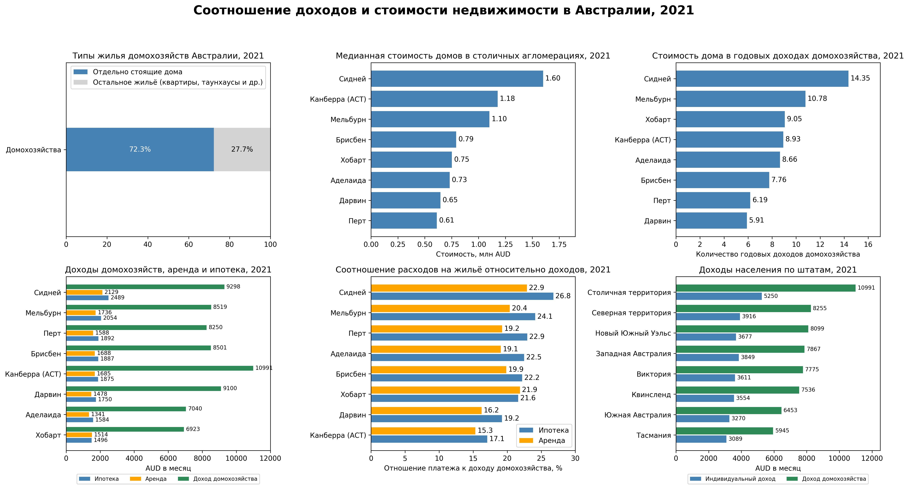

# Австралия — анализ благополучия и долгосрочных перспектив развития

**Период исследования:** преимущественно 2021 год; продолжительность жизни — 2019–2021 годы.  
**Инструменты:** Python, Pandas, NumPy, Matplotlib, GeoPandas, Jupyter Notebook.

## Цель исследования

Целью исследования Австралии было выявление факторов устойчивого благополучия страны, а также косвенных признаков перспективного экономического развития страны в целом, основываясь на расчётных величинах, косвенно отражающих предпочтения жителей, вместо опросов общественного мнения.

В центре анализа — жилищные условия и стоимость недвижимости в сопоставлении с доходами домохозяйств. Дополнительно исследуются география расселения, образование, продолжительность жизни и медицинское страхование.

## Данные

- **Australian Bureau of Statistics (ABS):** перепись населения 2021 года (таблицы G01, G02, G42, G49B на уровне SA2); оценка численности населения; географический справочник и границы штатов; статистика продолжительности жизни.
- **Domain:** медианные цены домов и квартир в столичных агломерациях, IV квартал 2021 года.
- **Australian Prudential Regulation Authority (APRA):** доля населения с частным страхованием госпитального лечения на 31 декабря 2021 года.

Источники:

- [ABS — Census 2021 DataPacks](https://www.abs.gov.au/census/find-census-data/datapacks)
- [ABS — Regional Population, 2020–21](https://www.abs.gov.au/statistics/people/population/regional-population/2020-21)
- [ABS — ASGS Edition 3, границы 2021 года](https://www.abs.gov.au/statistics/standards/australian-statistical-geography-standard-asgs/edition-3-july-2021-june-2026/access-and-downloads/digital-boundary-files)
- [ABS — Life Expectancy](https://www.abs.gov.au/statistics/people/population/life-expectancy)
- [Domain — House Price Report, December 2021](https://www.domain.com.au/research/house-price-report/december-2021/)
- [APRA — Quarterly Private Health Insurance Statistics, December 2021 (PDF)](https://www.apra.gov.au/system/files/2022-03/Quarterly%20Private%20Health%20Insurance%20Statistics%20December%202021.pdf)

Точные имена файлов, используемых ноутбуком, перечислены в `data/raw/README.md`. Цены Domain и показатели APRA внесены в ноутбук вручную с указанием источников.

## Основные результаты

- **72,3%** занятых частных жилищ Австралии — отдельно стоящие дома.
- Медианная стоимость домов в Сиднее, Мельбурне и Канберре в IV квартале 2021 года превышала **1 млн AUD**.
- По расчётам для исследованных столичных агломераций стоимость дома соответствовала примерно **5,9–14,4 годовым доходам домохозяйства**. Показатель основан на агрегированных медианных доходах территорий SA2.
- В Северной территории ожидаемая продолжительность жизни составляла **76,3 года у мужчин и 81,0 года у женщин**, что ниже показателей большинства других штатов и территорий. Доля коренного населения здесь составляла **26,1%**.
- Доля жителей в возрасте от 15 лет с высшим и последипломным образованием в расчёте исследования — **26,3%**; охват населения частным страхованием госпитального лечения по данным APRA — **44,9%**.

**Исследовательская гипотеза:** распространённость дорогостоящих отдельно стоящих домов и готовность домохозяйств к долгосрочным жилищным обязательствам *могут* косвенно говорить об уверенности в экономическом и правовом будущем страны. Этот вывод не трактуется как доказанная причинно-следственная связь.

Полные авторские выводы и ограничения исследования находятся в конце ноутбука.

## Визуализации

**Жилищные условия, стоимость недвижимости и доходы**

Остальные визуализации:

- [Численность населения по штатам и территориям](visualizations/australia_population_map_2021.png)
- [Доля и численность коренного населения](visualizations/australia_indigenous_share_2021.png)
- [Образование, продолжительность жизни и медицинское страхование](visualizations/australia_education_health_2021.png)

## Методология и ограничения

- Основной период данных — 2021 год. Данные о продолжительности жизни относятся к 2019–2021 годам.
- Доходы штатов и агломераций рассчитаны как **среднее медианных значений отдельных территорий SA2**, а не как официальные медианы штата или города.
- Расчёт стоимости недвижимости относительно годового дохода сопоставляет показатели разных статистических совокупностей; это ориентир, а не фактическая финансовая нагрузка каждой семьи.
- Доля отдельно стоящих домов относится к существующим занятым частным жилищам, а не к новым объектам строительства и не показывает индивидуальные мотивы выбора жилья.
- Выявленные территориальные различия и авторские объяснения не устанавливают причинность. Исследование одного периода не является самостоятельным прогнозом развития экономики.

## Структура проекта

- `README.md` — описание исследования, источников и результатов.
- `requirements.txt` — библиотеки Python, необходимые для работы.
- `notebooks/` — Jupyter Notebook с кодом исследования.
- `visualizations/` — четыре итоговые визуализации.
- `data/raw/` — исходные данные для анализа.

## Как запустить

1. Скачайте репозиторий и установите Python. Ноутбук создавался в среде Python 3.13.5.
2. Установите зависимости: `python -m pip install -r requirements.txt`.
3. Добавьте необходимые исходные файлы в `data/raw/` согласно списку в `data/raw/README.md`. Для ESRI Shapefile нужны не только `.shp`, но и сопутствующие `.shx`, `.dbf`, `.prj`.
4. Откройте `notebooks/Australia_Regional_Analysis.ipynb` в Jupyter или VS Code и выполните все ячейки по порядку. Пути в ноутбуке рассчитаны на расположение файла в каталоге `notebooks/`.

**Важно:** в подготовленном архиве исходные таблицы ABS отсутствуют, поэтому повторный запуск без их добавления невозможен. Сохранённые результаты и графики доступны для просмотра без запуска кода.
